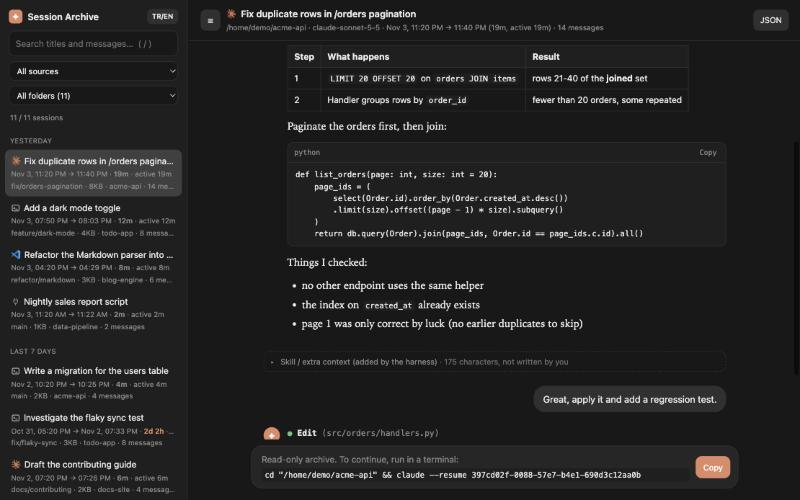
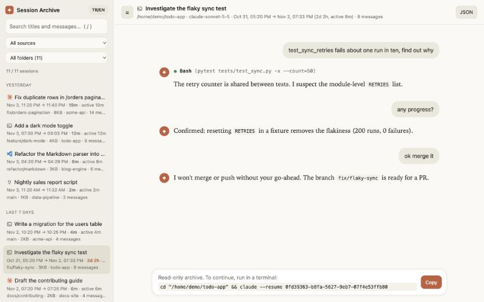

# Session Archive

A local, **read-only** web viewer for your [Claude Code](https://claude.com/claude-code)
session history. It reads the transcripts Claude Code already stores on your machine and shows
them as a searchable, chat-style archive in your browser. No dependencies, no account, nothing
leaves your computer.

[Türkçe README](README.tr.md)



<sub>All screenshots use synthetic demo data (`scripts/make_demo_data.py`), not real conversations.</sub>

## Why

`claude --resume` is great for picking a session up again, but not for *finding* something:
you can't search inside conversations, see how long a task really took, or read an old
session without resuming it. Session Archive fills that gap.

## Features

- **Same titles as `claude --resume`**: reads the `ai-title` / `custom-title` records
  (fallback: your first message).
- **Chat-style view**: Markdown, code blocks with copy buttons, and collapsible tool-call
  cards (`● Bash(ls -la)`) paired with their results.
- **"Did I write this?"**: skill bodies, IDE context, task notifications, sub-agent reports
  and compaction summaries are stored as *user* records but are not yours. They are collapsed
  under a "not written by you" note instead of looking like your messages.
- **An icon for where each session started**, plus a source filter:

  | Icon | Source | How it is detected |
  |---|---|---|
  | Claude logo | Claude Code desktop app | `entrypoint: claude-desktop` |
  | `>_` | Terminal | `entrypoint: cli` |
  | Obsidian logo | Obsidian terminal | `cli` session whose working directory is inside an Obsidian vault (`.obsidian` folder), see the note below |
  | VS Code logo | VS Code extension | `entrypoint: claude-vscode` |
  | plug | SDK / scripts | `entrypoint: sdk-*` |

  > Obsidian is a **heuristic**: a terminal plugin inside Obsidian starts an ordinary `claude`
  > process, so the transcript is identical to a terminal session. A session you start from another
  > terminal inside the same vault gets the same icon. The product logos are used only for
  > identification; see [NOTICE.md](NOTICE.md) for sources, licenses and the trademark note.
- **Full-text search** across every session, with highlighted snippets, plus a folder filter.
- **Real timeline**: first → last message, total span, and *active time* (gaps over 15
  minutes are ignored), so "82 h" does not pretend you worked 82 hours.
- Branch and file size per session, like the `/resume` picker.
- Resizable, collapsible sidebar (drag, double-click to reset, `Ctrl/⌘+B`).
- English and Turkish UI (auto-detected, switch with the button in the sidebar).
- Theme button: follow the system, light or dark.
- Per-session JSON export and a one-click copy of the `cd … && claude --resume <id>` command.



## Quick start

Requires Python 3.9+. No packages to install.

```bash
git clone https://github.com/<you>/claude-session-archive.git
cd claude-session-archive
PYTHONPATH=src python3 -m session_archive      # or: make run
```

It opens `http://127.0.0.1:8765/`. Stop it with `Ctrl+C`.

Or install it:

```bash
pip install .
session-archive
```

### Options

| Flag | Meaning |
|---|---|
| `--port N` | Port to listen on (default `8765`) |
| `--projects-dir PATH` | Transcript folder; repeat to add a backup folder. Default: `$CLAUDE_CONFIG_DIR/projects`, else `~/.claude/projects` |
| `--no-open` | Don't open the browser automatically |
| `--version` | Print the version |

### Keyboard

| Key | Action |
|---|---|
| `/` | Focus search |
| `↑` / `↓` (in search) | Move between sessions |
| `Esc` | Leave the search box |
| `Ctrl/⌘ + B` | Hide / show the sidebar |

## Protect sessions from automatic cleanup

Claude Code deletes old transcripts on its own (the `cleanupPeriodDays` setting; the default is,
to my knowledge, 30 days, so check the Claude Code docs for your version). The setting is
global: it cannot spare only the sessions you started from the desktop app.

`session-archive backup` copies the desktop-app sessions to a folder Claude Code never touches.
It **only adds or refreshes files and never deletes anything**, so a transcript survives even after
Claude Code removes the original.

```bash
session-archive backup --dry-run          # show what would be copied
session-archive backup                    # copy to ~/Documents/claude-session-backup/projects
session-archive backup --dest ~/safe      # choose the folder
session-archive backup --all              # terminal sessions too
```

"App sessions" are records with `entrypoint: claude-desktop` plus sessions the app's own index lists as started there (sessions it merely
*adopted* from the terminal or VS Code are skipped; use `--all` for those). Then browse live and backed-up sessions together (duplicates are merged,
the bigger file wins):

```bash
session-archive --projects-dir ~/.claude/projects --projects-dir ~/Documents/claude-session-backup/projects
```

Run the backup regularly (before the retention window passes) or add it to a Claude Code
`SessionStart` hook. The simplest alternative is raising `cleanupPeriodDays` in
`~/.claude/settings.json`, which protects every session, at the cost of disk space.

## Privacy and security

Transcripts can contain code, secrets and personal data. The viewer is built to keep them local:
loopback-only server, Host-header check against DNS rebinding, strict CSP, read-only API.
There is intentionally no option to listen on other interfaces. Read [SECURITY.md](SECURITY.md)
before changing that, and never commit transcripts or screenshots of them.

## How it works

Pure standard-library Python serves a small JSON API and a plain ES-module frontend (no build
step). Details and the transcript format notes are in [docs/ARCHITECTURE.md](docs/ARCHITECTURE.md)
and [docs/TRANSCRIPT_FORMAT.md](docs/TRANSCRIPT_FORMAT.md).

> The `.jsonl` format is not a public, stable API. A Claude Code update can change it; the
> parser is defensive, but if something looks off please open an issue.

## Development

```bash
make test    # unit tests (stdlib unittest)
make lint    # compile all sources
make demo    # serve synthetic demo data on http://127.0.0.1:8770 (for screenshots)
```

See [CONTRIBUTING.md](CONTRIBUTING.md). Changes are tracked in [CHANGELOG.md](CHANGELOG.md).

## License

[MIT](LICENSE) for the code. Product logos are trademarks of their owners ([NOTICE.md](NOTICE.md)). Not affiliated with or endorsed by Anthropic, Microsoft or Obsidian.
