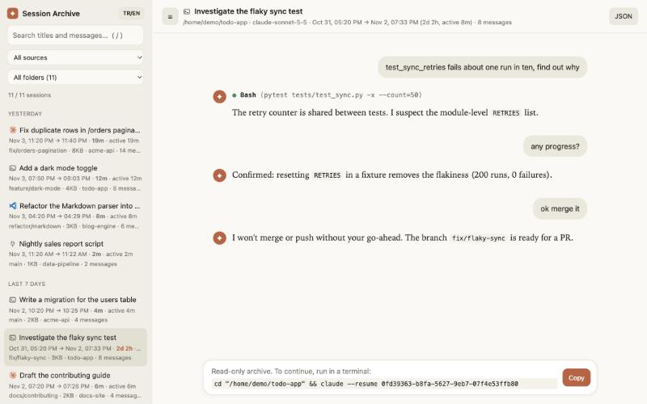

# Oturum Arşivi (Session Archive)

[Claude Code](https://claude.com/claude-code) oturum geçmişiniz için yerel ve **salt okunur** bir web
arayüzü. Claude Code'un makinenizde zaten sakladığı kayıtları okur ve tarayıcıda aranabilir, sohbet
görünümlü bir arşiv olarak gösterir. Bağımlılık yok, hesap yok, hiçbir veri bilgisayarınızdan çıkmaz.

[English README](README.md)


<sub>Tüm ekran görüntüleri sahte demo verisiyle alındı (`scripts/make_demo_data.py`), gerçek konuşma değildir.</sub>

## Neden

`claude --resume` bir oturuma devam etmek için iyidir, ama bir şeyi *bulmak* için değil: konuşmaların
içinde arama yapamazsınız, bir işin gerçekte ne kadar sürdüğünü göremezsiniz, eski bir oturumu devam
ettirmeden okuyamazsınız. Session Archive bu boşluğu doldurur.

## Özellikler

- **`claude --resume` ile aynı başlıklar:** `ai-title` / `custom-title` kayıtlarını okur
  (yoksa ilk mesajınızı kullanır).
- **Sohbet görünümü:** Markdown, kopyalama düğmeli kod blokları ve sonuçlarıyla eşleşmiş, kapanabilir
  araç kartları (`● Bash(ls -la)`).
- **"Bunu ben mi yazdım?":** Skill içerikleri, IDE bağlamı, görev bildirimleri, alt ajan raporları ve
  özetler kayıtta *kullanıcı* olarak durur ama sizin değildir. Mesajınız gibi görünmek yerine
  "sen yazmadın" notu altında kapalı gelir.
- **Her oturumun nereden başladığını gösteren ikon** ve kaynak filtresi:

  İstediğinizi `on`/`off` ile gizleyin ya da bir klasöre kendi ikonunu verin ([Yapılandırma](#yapılandırma)).

  | İkon | Kaynak | Nasıl tespit edilir |
  |---|---|---|
  | Claude logosu | Claude Code masaüstü uygulaması | `entrypoint: claude-desktop` |
  | `>_` | Terminal | `entrypoint: cli` |
  | Obsidian logosu | Obsidian terminali | Çalışma klasörü bir Obsidian kasasının (`.obsidian` klasörü) içinde olan `cli` oturumu, aşağıdaki nota bakın |
  | VS Code logosu | VS Code eklentisi | `entrypoint: claude-vscode` |
  | fiş | SDK / betikler | `entrypoint: sdk-*` |

  > Obsidian bir **tahmindir**: Obsidian içindeki terminal eklentisi sıradan bir `claude` süreci
  > başlatır, bu yüzden kayıt terminal oturumundan ayırt edilemez. Aynı kasanın içinde başka bir
  > terminalden başlattığınız oturum da aynı ikonu alır. Ürün logoları yalnız ayırt etmek için
  > kullanılır; kaynaklar, lisanslar ve marka notu için [NOTICE.md](NOTICE.md) dosyasına bakın.
- **Tüm oturumlarda tam metin arama** (vurgulu alıntılarla) ve klasör filtresi.
- **Gerçek zaman çizgisi:** ilk → son mesaj, toplam süre ve *aktif süre* (15 dakikadan uzun
  boşluklar sayılmaz); yani "82 sa" yazması 82 saat çalıştığınız anlamına gelmez.
- Her oturum için dal ve dosya boyutu (`/resume` listesi gibi).
- Sürüklenerek boyutlanan, gizlenebilen kenar çubuğu (çift tıkla sıfırlanır, `Ctrl/⌘+B`).
- Türkçe ve İngilizce arayüz (otomatik algılanır, kenar çubuğundaki düğmeyle değişir).
- Tema düğmesi: sistemi izle, açık ya da koyu.
- Oturum başına JSON dışa aktarma ve `cd … && claude --resume <id>` komutunu tek tıkla kopyalama.



## Hızlı başlangıç

Python 3.9+ gerekir. Kurulacak paket yok.

```bash
git clone https://github.com/dogukannparlak/claude-session-archive.git
cd claude-session-archive
PYTHONPATH=src python3 -m session_archive      # ya da: make run
```

`http://127.0.0.1:8765/` açılır. `Ctrl+C` ile durur.

Ya da kurun:

```bash
pip install .
session-archive
```

### Yapılandırma

Hiçbir şey zorunlu değil. Portu, klasörü değiştirmek, bir ikonu gizlemek ya da bir klasöre kendi
ikonunu vermek için örneği kopyalayıp düzenleyin. Değerler `on`/`off`, bir sayı ya da bir yol yazmak
kadar kolay:

```bash
cp .env.example .env
```

```ini
PORT=9000
OPEN_BROWSER=off
CLAUDE_FOLDERS=~/.claude/projects, ~/Documents/claude-yedek/projects
SHOW_VSCODE=off
FOLDER_ICONS=~/work=server, ~/Documents/client-x=./icons/client-x.svg
```

Tüm ayarlar, örneklerle: [docs/CONFIGURATION.tr.md](docs/CONFIGURATION.tr.md).

### Seçenekler

| Bayrak | Anlamı |
|---|---|
| `--port N` | Dinlenecek port (varsayılan `8765`) |
| `--projects-dir YOL` | Kayıt klasörü; yedek klasörünü de eklemek için tekrarlayın. Varsayılan: `$CLAUDE_CONFIG_DIR/projects`, yoksa `~/.claude/projects` |
| `--no-open` | Tarayıcıyı otomatik açma |
| `--env-file YOL` | `./.env` yerine kullanılacak ayar dosyası ([Yapılandırma](#yapılandırma)) |
| `--version` | Sürümü yazdır |

### Klavye

| Tuş | İşlem |
|---|---|
| `/` | Aramaya odaklan |
| `↑` / `↓` (arama kutusunda) | Oturumlar arasında gez |
| `Esc` | Arama kutusundan çık |
| `Ctrl/⌘ + B` | Kenar çubuğunu gizle / göster |

## Otomatik silinmeye karşı koruma

Claude Code, eski kayıtları bir saklama süresinden sonra kendiliğinden siler (`cleanupPeriodDays`
ayarı; sürümünüzün varsayılanı için Claude Code belgelerine bakın). Ayar geneldir: yalnız
masaüstü uygulamasından başlattığınız oturumları koruyamaz.

`session-archive backup`, masaüstü uygulaması oturumlarını Claude Code'un dokunmadığı bir klasöre
kopyalar. **Yalnız ekler ya da yeniler, hiçbir şey silmez**; yani Claude Code orijinali silse bile
kayıt kalır.

```bash
session-archive backup --dry-run          # neyin kopyalanacağını göster
session-archive backup                    # ~/Documents/claude-session-backup/projects içine kopyala
session-archive backup --dest ~/guvenli   # klasörü seç
session-archive backup --all              # terminal oturumları da
```

Diğer bayraklar: `--projects-dir` (nereden okunacağı), `--app-index` (masaüstü uygulamasının oturum dizini).
Yedek klasörü `~/.claude` ile **aynı özel konuşmaları** içerir: paylaşılan ya da herkese açık
eşitlenen yerlerden ve git'ten uzak tutun.

"Uygulama oturumları", `entrypoint: claude-desktop` olan kayıtlar ve uygulamanın kendi dizininde
orada başlatılmış görünen oturumlardır (uygulamanın terminalden ya da VS Code'dan yalnızca
*devraldığı* oturumlar atlanır; onlar için `--all` kullanın). Canlı ve yedeklenmiş oturumları
birlikte görmek için (tekrarlar birleştirilir, büyük dosya kazanır):

```bash
session-archive --projects-dir ~/.claude/projects --projects-dir ~/Documents/claude-session-backup/projects
```

Yedeği saklama süresi dolmadan düzenli çalıştırın ya da bir Claude Code `SessionStart` hook'una
ekleyin. En basit alternatif, `~/.claude/settings.json` içinde `cleanupPeriodDays` değerini
yükseltmektir: her oturumu korur, bedeli disk alanıdır.

## Gizlilik ve güvenlik

Kayıtlar kod, gizli anahtar ve kişisel veri içerebilir. Araç bunları yerelde tutmak için tasarlandı:
yalnız loopback'e bağlanır, DNS rebinding'e karşı Host başlığını denetler, sıkı CSP uygular, API salt
okunurdur. Başka arayüzlerde dinleme seçeneği bilerek yoktur. Bunu değiştirmeden önce
[SECURITY.md](SECURITY.md) dosyasını okuyun; kayıtları ya da ekran görüntülerini asla depoya
eklemeyin.

## Nasıl çalışır

Yalnız standart kütüphaneli Python küçük bir JSON API'si ve sade bir ES modülü arayüzü sunar (derleme
adımı yok). Ayrıntılar ve kayıt biçimi notları [docs/ARCHITECTURE.md](docs/ARCHITECTURE.md) ve
[docs/TRANSCRIPT_FORMAT.md](docs/TRANSCRIPT_FORMAT.md) dosyalarında.

> `.jsonl` biçimi herkese açık, kararlı bir API değildir. Bir Claude Code güncellemesi onu
> değiştirebilir; ayrıştırıcı savunmacı yazıldı, ama bir şey yanlış görünürse lütfen issue açın.

## Geliştirme

```bash
make test    # birim testleri (standart kütüphane unittest)
make lint    # tüm kaynakları derle
make demo    # sahte demo verisini http://127.0.0.1:8770 üzerinde sun (ekran görüntüleri için)
```

Katkı için [CONTRIBUTING.md](CONTRIBUTING.md), değişiklikler için [CHANGELOG.md](CHANGELOG.md).

## Lisans

Kod için [MIT](LICENSE). Ürün logoları sahiplerinin ticari markasıdır ([NOTICE.md](NOTICE.md)).
Anthropic, Microsoft ya da Obsidian ile bağlantılı değildir ve onlarca onaylanmamıştır.
