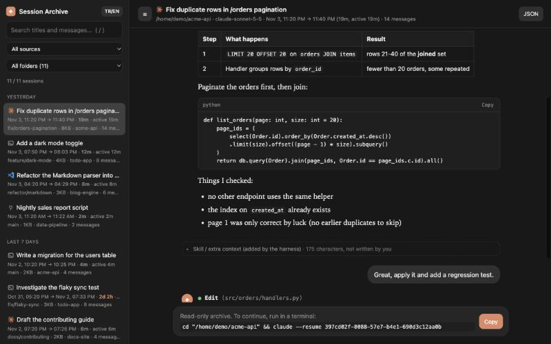

# Oturum Arşivi (Session Archive)

[Claude Code](https://claude.com/claude-code) oturum geçmişini gösteren yerel ve **salt okunur**
bir web arayüzü. Claude Code'un makinenizde zaten sakladığı kayıtları okur ve tarayıcıda aranabilir,
sohbet görünümlü bir arşiv olarak sunar. Bağımlılık yok, hesap yok, hiçbir veri bilgisayarınızdan çıkmaz.

[English README](README.md)

## Neden

`claude --resume` bir oturuma devam etmek için iyi, ama bir şeyi *bulmak* için değil: konuşmaların
içinde arama yapamaz, bir işin gerçekte ne kadar sürdüğünü göstermez, eski bir oturumu devam
ettirmeden okutmaz. Bu araç bu boşluğu doldurur.

## Özellikler

- **`claude --resume` ile aynı başlıklar:** `ai-title` / `custom-title` kayıtlarını okur
  (yoksa ilk mesajınızı kullanır).
- **Sohbet görünümü:** Markdown, kopyalama düğmeli kod blokları, sonuçlarıyla eşleşmiş kapanabilir
  araç kartları (`● Bash(ls -la)`).
- **"Bunu ben mi yazdım?":** Skill içerikleri, IDE bağlamı, görev bildirimleri, alt ajan raporları ve
  özetler kayıtta *kullanıcı* olarak durur ama sizin değildir. Mesajınız gibi görünmek yerine
  "sen yazmadın" notu altında kapalı gelir.
- **Her oturumun nereden başladığını gösteren ikon** ve kaynak filtresi: Claude logosu = Claude Code uygulaması,
  `>_` terminal, Obsidian logosu = Obsidian terminali, VS Code logosu, fiş = SDK/betik. Obsidian bir **tahmindir**:
  Obsidian içindeki terminal eklentisi sıradan bir `claude` süreci başlatır, kayıt terminalden
  ayırt edilemez; çalışma klasörü bir Obsidian kasasındaysa (`.obsidian` klasörü) Obsidian sayılır.
  Ürün logoları yalnız ayırt etmek içindir; kaynaklar ve marka notu için [NOTICE.md](NOTICE.md).
- **Tüm oturumlarda tam metin arama** (vurgulu alıntı) ve klasör filtresi.
- **Gerçek zaman çizgisi:** ilk → son mesaj, toplam süre ve *aktif süre* (15 dakikadan uzun
  boşluklar sayılmaz).
- Her oturum için dal ve dosya boyutu (`/resume` listesi gibi).
- Sürüklenerek boyutlanan, gizlenebilen panel (`Ctrl/⌘+B`).
- Türkçe ve İngilizce arayüz (otomatik algılanır, kenar çubuğundaki düğmeyle değişir).
- Oturum başına JSON dışa aktarma ve `cd … && claude --resume <id>` komutunu tek tıkla kopyalama.



<sub>Ekran görüntüleri sahte demo verisiyle alındı (`scripts/make_demo_data.py`).</sub>

## Hızlı başlangıç

Python 3.9+ gerekir. Kurulacak paket yok.

```bash
git clone https://github.com/<kullanici>/claude-session-archive.git
cd claude-session-archive
PYTHONPATH=src python3 -m session_archive      # ya da: make run
```

`http://127.0.0.1:8765/` açılır. `Ctrl+C` ile durur.

Seçenekler: `--port N`, `--projects-dir YOL` (varsayılan `$CLAUDE_CONFIG_DIR/projects`, yoksa
`~/.claude/projects`), `--no-open`, `--version`.

## Otomatik silinmeye karşı koruma

Claude Code eski kayıtları kendiliğinden siler (`cleanupPeriodDays` ayarı; varsayılanın 30 gün
olduğunu biliyorum ama sürümünüz için Claude Code belgelerine bakın). Ayar geneldir: yalnız masaüstü
uygulamasından açtığınız oturumları koruyamaz.

`session-archive backup`, uygulama oturumlarını Claude Code'un dokunmadığı bir klasöre kopyalar.
**Yalnız ekler/yeniler, hiçbir şey silmez**; yani Claude Code orijinali silse de kopya kalır.

```bash
session-archive backup --dry-run          # neyin kopyalanacağını göster
session-archive backup                    # ~/Documents/claude-session-backup/projects içine kopyala
session-archive backup --dest ~/guvenli   # klasörü seç
session-archive backup --all              # terminal oturumları da
```

Canlı ve yedeklenmiş oturumları birlikte görmek için:
`session-archive --projects-dir ~/.claude/projects --projects-dir ~/Documents/claude-session-backup/projects`

Saklama süresi dolmadan düzenli çalıştırın. Her oturumu korumanın en basit yolu,
`~/.claude/settings.json` içinde `cleanupPeriodDays` değerini yükseltmektir (disk kullanımı artar).

## Gizlilik ve güvenlik

Oturum kayıtları kod, gizli anahtar ve kişisel veri içerebilir. Araç bunları yerelde tutmak için
tasarlandı: yalnız loopback'e bağlanır, Host başlığını denetler (DNS rebinding), sıkı CSP uygular,
API salt okunurdur. Başka arayüzde dinleme seçeneği bilerek yoktur. Ayrıntı: [SECURITY.md](SECURITY.md).
Kayıtları ya da ekran görüntülerini depoya **eklemeyin**.

## Geliştirme

```bash
make test
make lint
```

Katkı için [CONTRIBUTING.md](CONTRIBUTING.md), değişiklikler için [CHANGELOG.md](CHANGELOG.md).

## Lisans

[MIT](LICENSE) (kod için). Ürün logoları sahiplerinin ticari markasıdır ([NOTICE.md](NOTICE.md)). Anthropic, Microsoft ya da Obsidian ile bağlantılı değildir.
